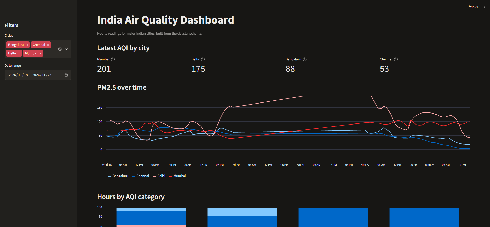
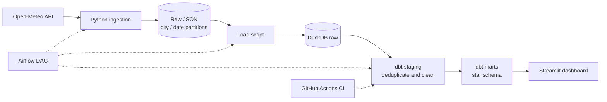
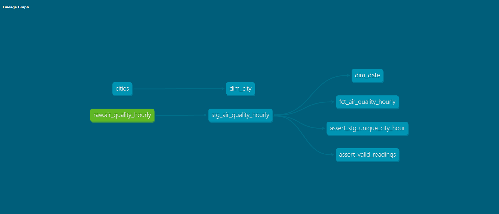
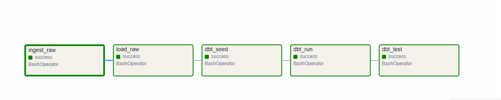

# India Air Quality Data Pipeline


An end-to-end data pipeline that collects hourly air quality data for Mumbai, Delhi, Bengaluru and Chennai, models it into a star schema and shows it in a dashboard. It uses only free, open-source tools.



## Architecture



## Tech stack

Python, DuckDB, dbt, Apache Airflow (Docker), GitHub Actions, pytest, Streamlit

## What it does

1. Ingests hourly readings from the Open-Meteo API and saves untouched raw JSON, partitioned by city and date.
2. Loads the raw files into DuckDB and flattens them into one row per city per hour.
3. Uses dbt to deduplicate overlapping readings and build a star schema (one fact table, city and date dimensions).
4. Tests data quality with dbt tests and checks row counts in CI.
5. Runs daily through an Airflow DAG with retries.
6. Serves the results in a Streamlit dashboard.




## Design decisions

- Raw data is kept untouched, so I can reprocess without calling the API again.
- Every step is idempotent, so reruns and Airflow retries never create duplicates.
- Staging keeps the latest copy of each city-hour, because each daily file repeats yesterday's hours.
- CI uses generated sample data instead of the live API, so a failure means my code broke, not the network.

## How to run

```bash
git clone https://github.com/<your-username>/india-air-quality-pipeline.git
cd india-air-quality-pipeline
python -m venv venv
venv\Scripts\activate
pip install -r requirements.txt

python ingestion/ingest.py
python load/load_raw.py
cd transform
dbt build --profiles-dir .
cd ..

streamlit run dashboard/app.py
```

To run it with Airflow instead, use `docker compose up --build` and open http://localhost:8080.

## Testing

```bash
ruff check .
python -m pytest
```

## Limitations and next steps

- Ingestion uses today's date, not Airflow's logical date, so backfills aren't supported yet.
- Airflow runs in standalone mode with SQLite, which is fine for a demo but not for production.
- To scale, I would move to S3 and a cloud warehouse such as Snowflake or Athena, make the dbt models incremental, and use a Postgres-backed Airflow.

Data source: [Open-Meteo](https://open-meteo.com/)